  

  

    
    
    
    
  

  <h3>Software Engineering Student · Full-Stack Developer · Product Builder</h3>
  
From an idea to a working product: I enjoy building software that solves practical problems.

---

## ✦ About

<table>
  <tr>
    <td width="58%" valign="top">
      <h3>Hey, I'm Zain.</h3>
      I'm a developer from Pakistan focused on full-stack applications, mobile products, and practical automation.
      <ul>
        <li>Building web and Flutter applications from end to end.</li>
        <li>Exploring AI-powered workflows, APIs, databases, and cloud tools.</li>
        <li>Interested in clean architecture, thoughtful UI/UX, and useful features.</li>
        <li>Learning by shipping, testing, and improving real projects.</li>
      </ul>
    </td>
    <td width="42%" valign="top">
      <h3>Current focus</h3>
      
▸ React · Next.js · TypeScript

      
▸ Flutter · Dart

      
▸ Python · Node.js · APIs

      
▸ Supabase · Firebase · SQL

      
▸ AI integration · Automation

    </td>
  </tr>
</table>

## ✦ Selected work

<table>
  <tr>
    <td width="50%" valign="top">
      <h3>🏭 <a href="https://github.com/Zain1098/factoryflow">FactoryFlow</a></h3>
      
Factory workflow and operations platform, with mobile app functionality and a protected administration area.

      Flutter · Supabase · Mobile
    </td>
    <td width="50%" valign="top">
      <h3>📄 <a href="https://github.com/Zain1098/Resume-Builder">CareerCraft / Resume Builder</a></h3>
      
Interactive ATS-focused resume builder with live A4 preview, templates, editing tools, and PDF export.

      Next.js · React · TypeScript · Tailwind
    </td>
  </tr>
  <tr>
    <td width="50%" valign="top">
      <h3>⌗ <a href="https://github.com/Zain1098/QR-code-generator">QRForge</a></h3>
      
QR creation and management platform with multiple QR types, customization, dynamic links, and scan analytics.

      Next.js · TypeScript · Supabase
    </td>
    <td width="50%" valign="top">
      <h3>⚡ <a href="https://github.com/Zain1098/fitforge">FitForge</a></h3>
      
Motion-rich fitness web application with workout, nutrition, progress, and dashboard experiences.

      React · Vite · Tailwind CSS · Framer Motion
    </td>
  </tr>
  <tr>
    <td width="50%" valign="top">
      <h3>⚖️ <a href="https://github.com/Zain1098/Find-a-Lawyer">Find a Lawyer</a></h3>
      
Full-stack legal discovery and appointment booking platform with advocate profiles, search, scheduling, and admin tools.

      PHP · MySQL · JavaScript · Bootstrap
    </td>
    <td width="50%" valign="top">
      <h3>💱 <a href="https://github.com/Zain1098/CurrenSee">CurrenSee</a></h3>
      
Currency application with live exchange rates, price alerts, financial updates, and multi-rate comparison.

      Flutter · Firebase
    </td>
  </tr>
  <tr>
    <td width="50%" valign="top">
      <h3>🌙 <a href="https://github.com/Zain1098/Islamic-Occasion-Planner">Islamic Occasion Planner</a></h3>
      
Offline-first planner for Hijri and Gregorian dates, reminders, event budgets, and local backups.

      Flutter · Dart · Offline-first
    </td>
    <td width="50%" valign="top">
      <h3>🧪 <a href="https://github.com/Zain1098">More experiments</a></h3>
      
UI experiments, developer utilities, prototypes, and smaller projects across my repositories.

      Explore all repositories ↗
    </td>
  </tr>
</table>

## ✦ Tech stack

  <h4>Frontend & UI</h4>
  
  <h4>Backend & Data</h4>
  
  <h4>Mobile & Tools</h4>
  

## ✦ GitHub activity

  
  

  

### Contribution snake

  <picture>
    <source media="(prefers-color-scheme: dark)" srcset="https://raw.githubusercontent.com/Zain1098/Zain1098/output/github-contribution-grid-snake-dark.svg" />
    <source media="(prefers-color-scheme: light)" srcset="https://raw.githubusercontent.com/Zain1098/Zain1098/output/github-contribution-grid-snake.svg" />
    
  </picture>

## ✦ How I build

  <code>DISCOVER</code>　→　<code>DESIGN</code>　→　<code>ENGINEER</code>　→　<code>TEST</code>　→　<code>SHIP</code>
    
  <b>Build with purpose. Learn continuously. Improve every release.</b>

---

  <a href="https://github.com/Zain1098">GitHub</a> ·
  <a href="https://instagram.com/zcodedev">Instagram</a> ·
  <a href="mailto:zainansari.net@gmail.com">Email</a>
   
  Designed & built by Zain Ansari · ZCodeDev

